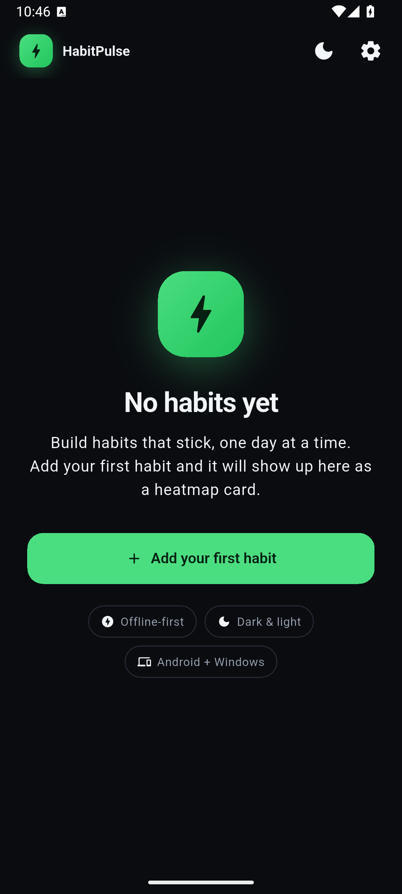
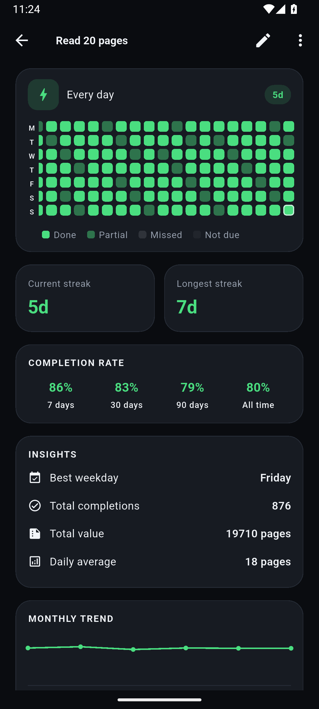
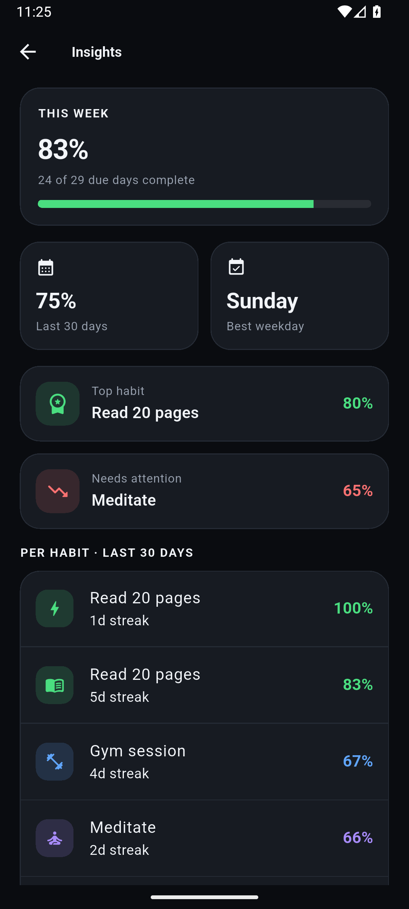

# HabitPulse

A focused habit tracker for Android phone, Android tablet and Windows —
offline-first, with heatmaps, streaks, reminders and optional cloud sync.

**Repository:** <https://github.com/monil301310/habitpulse>

One Flutter codebase builds both apps. The local database is Drift (SQLite),
state is Riverpod, and Supabase provides optional accounts and sync. Android adds
two home-screen widgets, and the UI adapts from phone bottom navigation to a
tablet/desktop rail with a two-pane Today view.

<p align="center">
  
  
  
</p>

> **Build status:** Phases 1–8 implemented. See [PROGRESS.md](PROGRESS.md) for
> verification, [DECISIONS.md](DECISIONS.md) for spec choices, and
> [docs/QA.md](docs/QA.md) for the manual checklist.

## Features

- **Four habit types:** yes/no, count, timed and negative (quit) habits.
- **Schedules:** every day, chosen weekdays, or X times per week.
- **Logging:** done, partial, missed, skipped, undo, and a note per day.
- **Heatmaps & insights:** per-habit contribution grid, streaks, completion
  rates, weekday averages, monthly trend and an account-wide insights tab.
- **Reminders:** multiple per habit, Android notification actions and Windows
  toasts, snooze, quiet hours, daily recheck and an optional morning recheck.
- **Cloud sync (optional):** email/password, magic link and Google sign-in;
  newest-write-wins conflict rules; realtime updates between devices.
- **Android widgets:** today checklist with tap-to-log and a heatmap card.
- **Responsive:** bottom navigation on phones, navigation rail on tablets and
  Windows, two-pane Today view when there is room.
- **Desktop:** keyboard shortcuts, tray icon, close-to-tray, start with Windows.
- **Data ownership:** JSON/CSV export, no analytics, local-first by default.

## Requirements

- Flutter **stable** (3.47.8+) at `C:\src\flutter` on Windows
- Visual Studio 2026 with **Desktop development with C++** (for Windows)
- Android Studio + Android SDK (for Android)

## Run

```powershell
flutter pub get
flutter run -d windows
flutter emulators --launch medium_phone
flutter run -d emulator-5554
```

The app starts in local-only mode. No account or network is required.

## Test

```powershell
flutter analyze
flutter test
```

Current suite: **116 tests** covering the domain rules, sync conflicts, export,
widget payloads and the adaptive shell.

## Cloud sync (optional)

1. Follow [SETUP_SUPABASE.md](SETUP_SUPABASE.md) to create the project and run
   [`supabase/schema.sql`](supabase/schema.sql).
2. Copy `.env.example` to `.env` and fill in `SUPABASE_URL` and
   `SUPABASE_ANON_KEY`.
3. Restart the app, then **Settings → Account → Sign in**.

`.env` is gitignored. Never put the Supabase `service_role` key in it.

## Android widgets

Long-press the home screen → **Widgets** → **HabitPulse**:

- **Today's habits** — tap a row to mark it done/cleared without opening the app.
- **Habit heatmap** — streak and grid for your first active habit.

## Desktop

- Resize the window: the rail gains labels, and Today becomes list + detail.
- Shortcuts: `Ctrl+N` new habit, `Ctrl+1/2/3` Today/Insights/Settings,
  `Ctrl+,` Settings, `Esc` back.
- Closing hides to the tray; right-click the tray icon to quit.
- Settings → Windows toggles **Start with Windows** and lists the shortcuts.

## Data export

**Settings → Data** writes:

- **JSON** — habits, reminders, logs and settings;
- **CSV** — one row per logged day.

On Windows the file opens in Explorer; on Android the share sheet appears. Files
go to Downloads (Windows) or the app documents folder (Android).

## Release builds

```powershell
# Android (signed with android/key.properties when present)
flutter build appbundle --release
flutter build apk --release

# Windows
flutter build windows --release
dart run msix:create
```

Android release signing uses `android/key.properties` pointing at a keystore
**outside the repository**; without that file the build falls back to debug
signing. The keystore and its password are recorded on the build machine, never
committed.

The Windows installer is produced by the `msix` package (`msix_config` in
`pubspec.yaml`) and is self-signed for local installation.

## Layout

| Path | Purpose |
| --- | --- |
| `lib/domain/` | Pure-Dart entities, enums, logic, export and repository interfaces |
| `lib/data/` | Drift database, repositories, sync engine, notifications, widgets |
| `lib/app/` | App root, theme, Riverpod providers, shortcuts |
| `lib/presentation/` | Screens, shell and widgets |
| `lib/core/` | Constants, Supabase config, Windows shell |
| `supabase/` | Database schema, RLS and realtime setup |
| `docs/` | QA checklist and screenshots |

## Regenerate the database code

```powershell
dart run build_runner build
```

Bump `AppConstants.schemaVersion` and add an `if (from < N)` step in
`AppDatabase.migration` (v4 is current).

## Privacy

HabitPulse stores your data locally. Cloud sync is opt-in and uses your own
Supabase project. See [PRIVACY.md](PRIVACY.md).

## Documents

- [PROGRESS.md](PROGRESS.md) — phase status and verification
- [DECISIONS.md](DECISIONS.md) — resolved ambiguities from the spec
- [SETUP_SUPABASE.md](SETUP_SUPABASE.md) — accounts and cloud sync setup
- [PRIVACY.md](PRIVACY.md) — privacy policy
- [docs/QA.md](docs/QA.md) — final QA checklist
